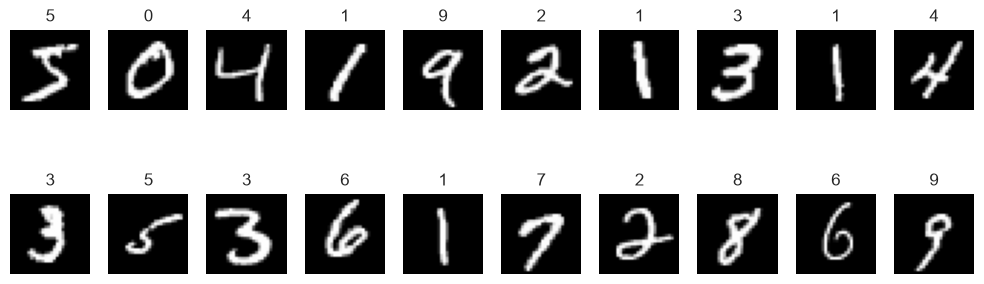
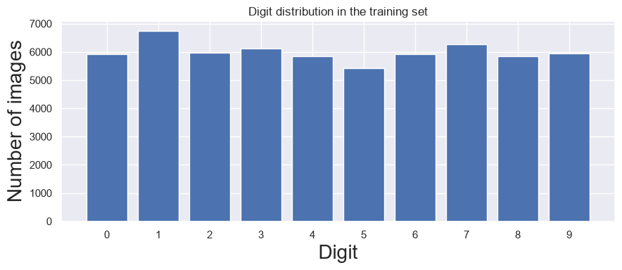
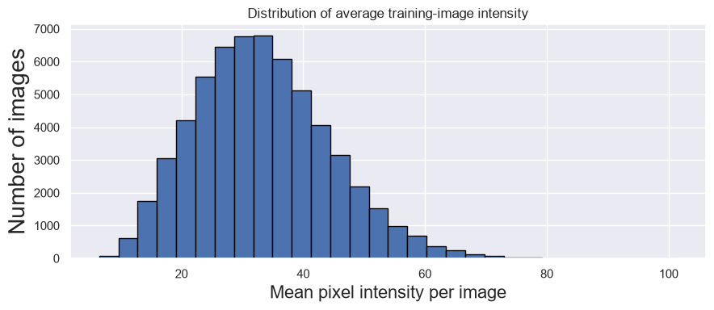
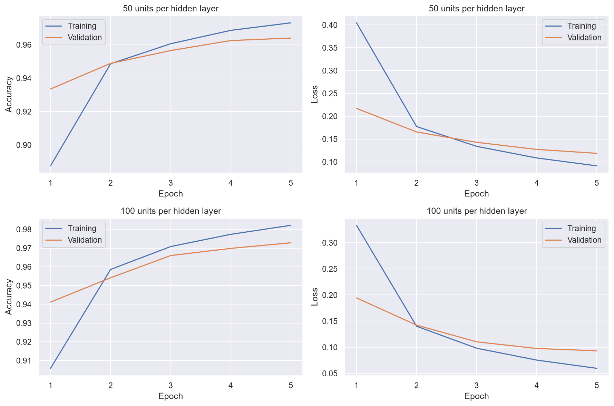
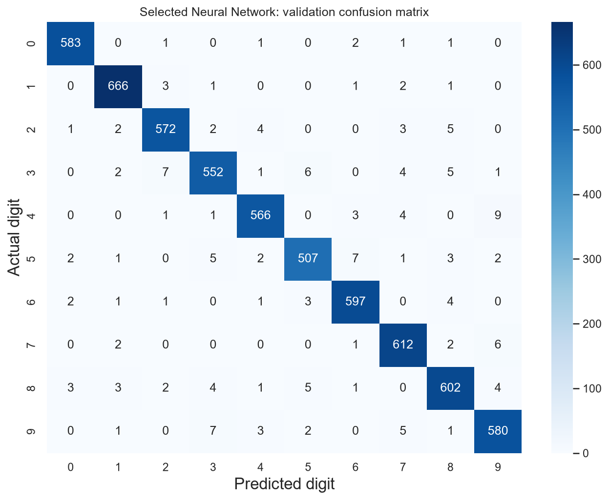
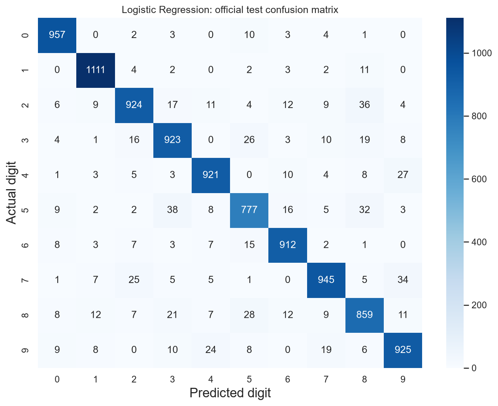
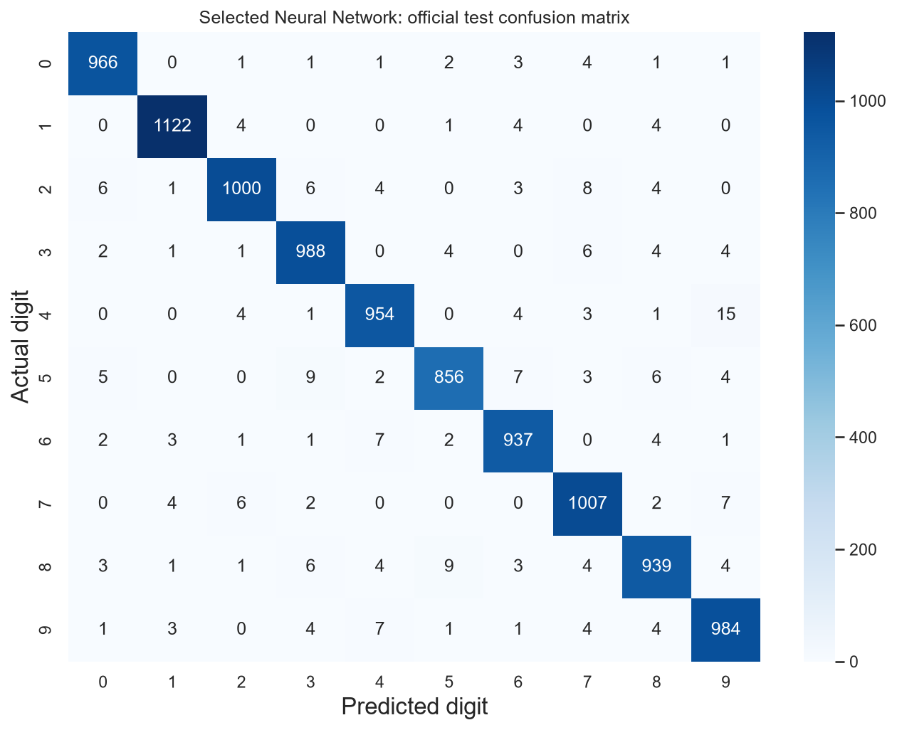
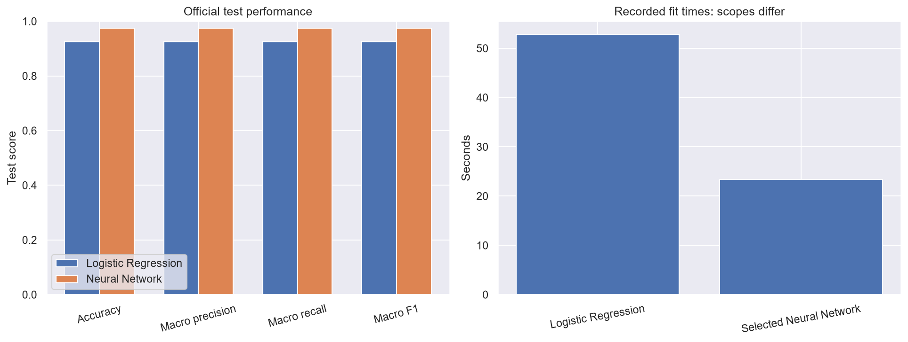
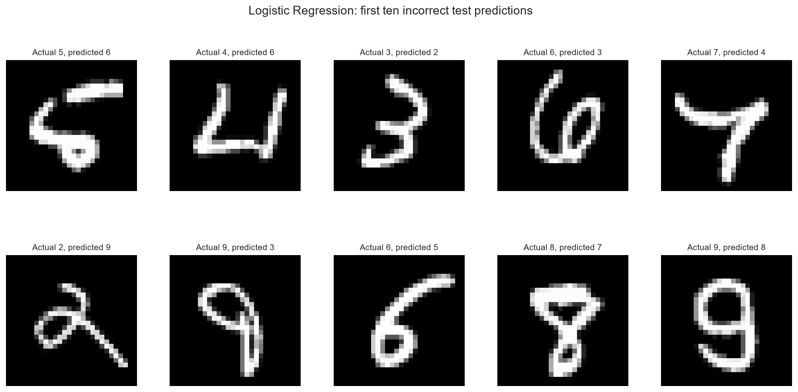
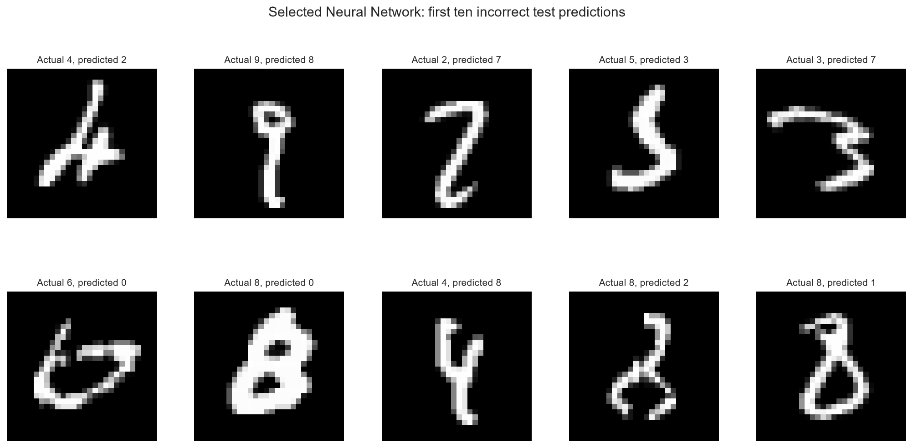

# Comparative Analysis of Machine Learning and Deep Learning Techniques for Handwritten Digit Recognition

**Student name:** AJIBADE DARASIMI MICHAEL  
**Matriculation number:** 2023/46544  
**University:** Osun State University  
**Faculty:** Faculty of Computing and Information Technology  
**Department:** Computer Science

## Abstract

This project compared a Scikit-learn Logistic Regression classifier with a simple TensorFlow/Keras neural network for recognising handwritten digits. The MNIST dataset supplied 60,000 development images and 10,000 images reserved for final testing. Exploratory analysis examined image structure, digit frequencies and pixel-intensity statistics. A fixed NumPy shuffle with seed 42 divided the development data into 54,000 training and 6,000 validation examples. Pixels were converted to float32 and divided by 255. Logistic Regression received 784 features per image, while the neural networks used a Flatten layer followed by two ReLU hidden layers and ten Softmax outputs. Two networks, containing 50/50 and 100/100 hidden units, were trained sequentially for five epochs with batch size 100 and Adam. The 100/100 network was selected using final validation accuracy of 97.2833%, compared with 96.4000% for the smaller network. Final evaluation of the frozen models gave Logistic Regression 92.54% test accuracy and 0.924303 macro F1, whereas the selected network achieved 97.53% accuracy and 0.975045 macro F1. The network made 247 errors, compared with 746 for Logistic Regression. These results favour the selected network for this experiment, while single-run measurements, different training-time scopes and the restricted MNIST setting limit generalisation. The implementation follows documented classroom methods with explicitly identified adaptations. This report uses existing experiment records; no training or new test prediction was performed during report preparation.

## 1. Introduction

Handwritten digit recognition is the task of assigning an image to one of the categories 0 to 9. People can write the same digit with different stroke thicknesses, slants, proportions and loops. Some shapes resemble more than one digit, making recognition an appropriate supervised classification problem. The supplied project brief asks for a comparison between Logistic Regression and a simple neural network using Python and MNIST [P1].

Data Science combines programming, statistical reasoning and subject knowledge to answer questions using data. Artificial Intelligence is the broader study of systems that perform tasks associated with intelligent behaviour. Machine Learning develops models that learn relationships from examples. Neural networks are one family of Machine Learning methods; networks with multiple representation layers are commonly studied within Deep Learning. Business Intelligence uses summaries and visualisations to support decisions. Here, tables and plots support an analytical comparison, although the project is a recognition experiment rather than a deployed business system.

The project follows a complete analytical sequence: data acquisition, exploration, numerical preparation, model fitting, validation-based experimentation, final held-out evaluation and interpretation. Both models receive the same image memberships and labels. Their predictions are compared using accuracy, macro precision, macro recall, macro F1, confusion matrices and recorded training times. No result was assumed in advance.

The main implementation is [MNIST_Final_Project.ipynb](../MNIST_Final_Project.ipynb), containing the completed exploration, preparation and validation experiments [P2]. Final evaluation is separated into [MNIST_Final_Evaluation.ipynb](../MNIST_Final_Evaluation.ipynb), which loads frozen models rather than rerunning training [P3]. These are the project's working stage labels; the brief numbers preparation, Logistic Regression and the neural network as separate methodology stages. This report describes the completed work rather than claiming that its local stage numbering reproduces the brief's numbering exactly.

## 2. Problem Statement

The problem is to learn a mapping from numerical images of handwritten digits to their correct integer labels despite variation in handwriting. A model must recognise previously unused examples rather than merely reproduce labels encountered during training.

The investigation asks whether a linear multiclass classifier or a small nonlinear neural network gives better measured recognition performance under the recorded experimental conditions. It also examines the kinds of errors each makes and the practical implications of its complexity and training procedure. The comparison is restricted to MNIST and the selected settings; it is not a claim about every recognition task, handwriting source or model configuration.

## 3. Project Objectives

The overall aim is to develop and compare Machine Learning and Deep Learning models for handwritten digit recognition using Python and MNIST, in accordance with the official brief [P1]. The specific objectives are to:

1. Inspect image dimensions, numerical types, labels, digit frequencies and introductory statistics using only the original training partition.
2. Present labelled digit examples and relevant statistical visualisations.
3. Construct reproducible, disjoint training and validation partitions and apply consistent numerical preprocessing.
4. Fit the required Scikit-learn Logistic Regression classifier and evaluate it on validation data.
5. Build classroom-style TensorFlow/Keras networks, test two hidden-layer widths and select using validation accuracy alone.
6. Compare the frozen models on the official test partition using the required classification metrics and recorded training times.
7. Explain the mathematics, classroom influences, experimental limitations and possible improvements using verifiable evidence.

## 4. Background Research

### 4.1 MNIST and document recognition

The official Keras dataset documentation describes MNIST as 60,000 training images and 10,000 test images, with 28 by 28 grayscale pixels and ten digit classes. It identifies the data as a derivative of the original NIST datasets and links to the MNIST homepage. The TensorFlow loader documentation specifies NumPy uint8 arrays and integer labels from 0 to 9. These sources establish the dataset contract, while the project's own exploration verifies the arrays actually loaded [R1, R2].

Handwritten recognition also has an established academic literature. LeCun, Bottou, Bengio and Haffner's 1998 article, *Gradient Based Learning Applied to Document Recognition*, provides historical context for learning-based document recognition. Its authors, title, journal details and year were verified from the co-author's publication record [R3]. The present project does not reproduce that paper's architectures or claim its published results. It uses the small dense networks specified for this classroom-based comparison.

### 4.2 Logistic Regression

Despite its name, Logistic Regression is used here for classification. Scikit-learn's multiclass formulation assigns a weighted score to each class and obtains probabilities through a multinomial transformation. Regularisation discourages large coefficients; the documentation defines `C` as inverse regularisation strength. The `lbfgs` solver supports the required multiclass setting [R4, R5]. This makes it a useful baseline with a direct relationship between pixel features and class scores.

The lecturer's binary Statsmodels examples establish the sequence of selecting inputs and targets, fitting a model, predicting and comparing predicted with actual values. The project extends this reasoning to ten classes and uses Scikit-learn because the brief explicitly requires that library. This adaptation changes the API and statistical specification; it should not be described as an identical replication of the binary lesson.

### 4.3 Neural networks and optimisation

A dense neural network combines weighted sums with activation functions. Keras documents standard ReLU as the elementwise maximum of zero and its input, and Softmax as transforming a score vector into nonnegative values summing to one [R6]. The project's hidden layers therefore introduce nonlinear transformations before its ten-class output.

Sparse categorical cross-entropy is appropriate when class labels are integers, as they are in this project [R7]. Adam adapts parameter updates using gradient information. Kingma and Ba's *Adam: A Method for Stochastic Optimization* was first submitted in 2014; its arXiv record also identifies its 2015 conference publication. Keras documents a default Adam learning rate of 0.001, agreeing with the value recorded in the saved project settings [R8, R9]. These sources explain the tools; they do not supply the accuracy values reported for this project.

### 4.4 Independent evaluation

Scikit-learn's guidance explains that test data should not influence model choices and that the same preprocessing must be applied to subsequent data [R10]. The project therefore selected network width using validation data and opened the official test set for final evaluation only after freezing both models. Published metric definitions support interpretation of precision, recall, F1 and averaging [R11, R12]. All experimental findings below come from project records rather than external benchmark tables.

## 5. Methodology

### 5.1 Computing environment and programming approach

The implementation used Python 3.11.17 in the dedicated Anaconda environment at `<active Python interpreter>`. Jupyter Notebook supplied sequential execution, displayed outputs and explanatory Markdown. NumPy stored and transformed image arrays. Pandas produced small descriptive and comparison tables. Matplotlib and Seaborn displayed images, distributions, learning curves and confusion matrices. Scikit-learn supplied Logistic Regression and classification metrics, while TensorFlow/Keras supplied the neural networks.

The recorded library versions are TensorFlow 2.21.0, Keras 3.15.1, NumPy 2.4.6, Pandas 3.1.0, Scikit-learn 1.9.1, Joblib 1.6.0, Matplotlib 3.11.2 and Seaborn 0.13.2 [P4-P6]. Online documentation supports conceptual explanations; the saved environment records establish which versions actually produced the results.

The computer has 8 GB RAM. The implementation retained raw uint8 images during exploration and avoided a large 784-column Pandas feature table. Normalised arrays used float32. Logistic Regression reshapes shared storage with the image arrays, although its solver could create an internal higher-precision working copy. The network trials ran sequentially and reused the prepared images. Computational thread environment variables were recorded as two. These choices reduced unnecessary copies; no claim is made that total peak memory was measured.

### 5.2 Classroom influence and necessary adaptations

The notebooks use familiar aliases (`np`, `pd`, `plt`, `seaborn`, `tf`), descriptive names such as `train_inputs` and `validation_targets`, and the lecturer's `x`, `y` and `reg_log` names where appropriate. Most modelling operations are direct sequential statements. There are no project CNNs, transfer-learning models, pipelines or custom training loops.

Appendix A identifies original source notebooks and one-based cell positions. Directly reused patterns include `.describe()`, array slicing and reshaping, shuffled indices, float32/divide-by-255 scaling, Keras Sequential construction and the build-compile-fit-evaluate sequence. Image display also follows the example in the official brief.

Necessary adaptations were documented rather than attributed to lessons without evidence. The required Keras MNIST loader replaces the classroom TensorFlow Datasets loader. Scikit-learn's ten-class Logistic Regression replaces Statsmodels' binary `Logit`; its intercept is handled internally, so no constant column is added. The network uses exactly ten output units, correcting the original example's use of the hidden-layer width at the output. NumPy arrays require input shape `(28, 28)` rather than the lesson's singleton-channel form. Fixed seeds, overlap checks, macro metrics, fit timing, native model persistence, SHA-256 verification and saved prediction records are additional reproducibility and evaluation measures.

### 5.3 Dataset acquisition and exploration

The required call was `tf.keras.datasets.mnist.load_data()`. Before importing TensorFlow/Keras, the notebook sets `KERAS_HOME` to the project's `.keras` directory. The existing file `.keras/datasets/mnist.npz` supplies the cache. Earlier offline verification confirmed local loading without network attempts. No alternate digit dataset was substituted [P2, P6].

Exploration used only the original 60,000 training examples. The required loader returned the official test arrays, but they were not used for exploratory statistics, training or selection. The analysis checked shape, number of dimensions, dtype, pixel range and label values; displayed fixed samples; counted classes; and summarised pixel intensities. The small Pandas table contained labels and per-image average brightness, not all image features.

For $n$ numerical observations $a_i$, the mean is $\bar a=\frac{1}{n}\sum_{i=1}^{n}a_i$. Population standard deviation is $\sigma=\sqrt{\frac{1}{n}\sum_{i=1}^{n}(a_i-\bar a)^2}$, describing spread around that mean. The global pixel calculation used NumPy's population convention (`ddof=0`). Pandas `.describe()` instead reported sample standard deviation (`ddof=1`) across the 60,000 per-image averages. These are different measurements. Digit labels are categories; their arithmetic mean was not interpreted as an average digit.

For digit $k$, its empirical training frequency is $n_k/60000$, where $n_k$ is its observed count. This is an observed class proportion, distinct from a model's conditional probability for a particular image.

### 5.4 Image representation and normalisation

An image is a matrix $I\in\mathbb{R}^{28\times28}$. Its entry $I_{r,c}$ is the grayscale intensity at row $r$, column $c$: zero is black and 255 is white. Intermediate intensities describe gray levels, rather than different digit categories.

The preparation rule was:

$$
\widetilde I_{r,c}=\frac{\operatorname{float32}(I_{r,c})}{255}.
$$

This maps pixels to the interval [0, 1] without estimating any statistic from validation or test images. Normalisation was applied exactly once. It is not standardisation to zero mean and unit variance. Integer labels were retained unchanged.

For Logistic Regression, row-major reshaping produces a vector $x\in\mathbb{R}^{784}$, since $28\times28=784$. A feature corresponds to a fixed pixel position. For the neural network, the prepared array retains its two-dimensional image shape until Flatten rearranges it internally. Flatten has no learned parameters and does not itself normalise pixels.

### 5.5 Reproducible training-validation split

The notebook set `np.random.seed(42)`, created `np.arange(60000)`, shuffled those indices once with `np.random.shuffle`, and used the first 54,000 indices for training and the remaining 6,000 for validation. Applying identical indices to images and labels preserved their pairing. This was a random, unstratified 90%/10% split of the original training partition; it did not repartition the official test examples [P4].

Assertions verified zero overlap and complete coverage of all original training indices. The indices were saved in `results/stage2/split_indices.npz`. Stage 3 checked the same arrays and hashes, image shapes and labels against Stage 2. Neural-network training may shuffle the fitting order during epochs, but it does not change partition membership.

Training data update learned parameters. Validation data assess settings and progress without updating weights. The official 10,000-image test set was reserved for a final assessment after the network configuration was selected. Both final models retained their original 54,000-image training fits; they were not refitted on the combined training and validation data.

**Table 1. Digit counts in the original training partition and its fixed subdivisions. Source: Stage 1 cell 26 and `results/stage2/split_distribution.csv`.**

| Digit | Original training | Fitting partition | Validation partition |
|---|---:|---:|---:|
| 0 | 5,923 | 5,334 | 589 |
| 1 | 6,742 | 6,068 | 674 |
| 2 | 5,958 | 5,369 | 589 |
| 3 | 6,131 | 5,553 | 578 |
| 4 | 5,842 | 5,258 | 584 |
| 5 | 5,421 | 4,891 | 530 |
| 6 | 5,918 | 5,309 | 609 |
| 7 | 6,265 | 5,642 | 623 |
| 8 | 5,851 | 5,226 | 625 |
| 9 | 5,949 | 5,350 | 599 |
| Total | 60,000 | 54,000 | 6,000 |

### 5.6 Logistic Regression specification and mathematics

The implementation constructed `reg_log = LogisticRegression(C=1.0, solver='lbfgs', max_iter=1000)` and called `.fit(x, y)` using only fitting-partition arrays. The recorded tolerance was 0.0001 and `fit_intercept=True`. Default L2 regularisation was retained; deprecated arguments were not explicitly supplied [P4].

For class $k\in\{0,\ldots,9\}$, define a score and probability:

$$
z_k=\sum_{j=1}^{784}w_{kj}x_j+b_k,
\qquad p_k=\frac{e^{z_k}}{\sum_{l=0}^{9}e^{z_l}},
\qquad \widehat y=\arg\max_k p_k.
$$

Here $x_j$ is a normalised pixel feature, $w_{kj}$ is its learned coefficient for class $k$, and $b_k$ is that class's intercept. The probabilities sum to one. The actual prediction call returns the most likely digit; there is no binary 0.5 cutoff. The multinomial model optimises cross-entropy together with regularisation [R5]. A smaller `C` would strengthen regularisation, but `C` was not tuned in this experiment [R4].

No hidden layers or hand-engineered image features were introduced. The fit completed in 235 solver iterations with zero fit warnings and zero convergence warnings. `max_iter=1000` is an iteration ceiling, not a neural-network epoch count. Timing surrounded the fit call only and excluded preparation, prediction, plotting and saving [P4].

### 5.7 Neural-network specifications and experiment

Both models used `Sequential`, an explicit Input, Flatten, two Dense/ReLU layers and a Dense/Softmax output. Their architectures were:

- 50/50 trial: Input(28,28) → Flatten(784) → Dense(50, ReLU) → Dense(50, ReLU) → Dense(10, Softmax).
- 100/100 trial: Input(28,28) → Flatten(784) → Dense(100, ReLU) → Dense(100, ReLU) → Dense(10, Softmax).

For a layer, $a^{(l)}=W^{(l)}h^{(l-1)}+b^{(l)}$ and $h^{(l)}=\operatorname{ReLU}(a^{(l)})$, with $h^{(0)}=x$. A weight matrix $W^{(l)}$ determines the contribution of preceding activations, and bias vector $b^{(l)}$ shifts each neuron's score. ReLU applies $\operatorname{ReLU}(a)=\max(0,a)$. The final layer applies the Softmax formula above instead of ReLU [R6]. Its ten positions correspond to digits 0 through 9. These probabilities are not guarantees of correctness.

A dense layer with $m$ inputs and $h$ outputs has $mh+h$ learned parameters, including biases. The 50/50 network therefore has $(784+1)50+(50+1)50+(50+1)10=42,310$ parameters. The 100/100 network has $(784+1)100+(100+1)100+(100+1)10=89,610$. The counts agree with the recorded model summaries [P5].

Both networks compiled with Adam, sparse categorical cross-entropy and accuracy. The mean classification loss can be written:

$$
L=-\frac{1}{N}\sum_{i=1}^{N}\log p_{i,y_i},
$$

where $N$ is the number of examples being averaged and $p_{i,y_i}$ is the probability assigned to example (i)'s true label $y_i$. Giving the correct class a low probability increases the loss. Integer labels work directly with the sparse loss, so one-hot encoding was unnecessary [R7]. Backpropagation computes gradients; Adam uses them to update weights and biases [R8, R9]. No neural-network L2 penalty, dropout or early stopping was added.

The code reset `tf.keras.utils.set_random_seed(42)` before each model. Both used five epochs, batch size 100 and the same saved validation data. The recorded Adam learning rate was approximately 0.001 (`0.0010000000474974513` in the saved representation). Only hidden-layer width changed. The same seed does not imply identical weights across differently shaped networks, nor guarantee identical outcomes on every software/hardware platform.

The 50/50 trial trained first, followed by the 100/100 trial. Each fit included validation after every epoch. Final fifth-epoch validation accuracy determined selection; an exact tie would favour the smaller model. Final-epoch weights were retained, with no earlier-epoch selection or additional tuning [P5].

### 5.8 Evaluation definitions

Let $y_i$ be the true label and $\widehat y_i$ the predicted label for $N$ examples. Accuracy is:

$$
\operatorname{Accuracy}=\frac{1}{N}\sum_{i=1}^{N}\mathbf{1}(y_i=\widehat y_i).
$$

The indicator is one for a correct prediction and zero otherwise. For each digit $k$, consider that digit against all other digits. True positives $TP_k$ are correctly predicted instances of $k$; false positives $FP_k$ are other digits predicted as $k$; false negatives $FN_k$ are true instances of $k$ predicted otherwise. Then:

$$
P_k=\frac{TP_k}{TP_k+FP_k},\qquad
R_k=\frac{TP_k}{TP_k+FN_k},\qquad
F1_k=\frac{2TP_k}{2TP_k+FP_k+FN_k}.
$$

Precision measures the reliability of predictions assigned to a class, and recall measures how many actual members are recovered. F1 balances these aspects [R11]. Support is the number of actual examples of a class.

The project used macro averaging:

$$
P_{\mathrm{macro}}=\frac{1}{10}\sum_{k=0}^{9}P_k,\quad
R_{\mathrm{macro}}=\frac{1}{10}\sum_{k=0}^{9}R_k,\quad
F1_{\mathrm{macro}}=\frac{1}{10}\sum_{k=0}^{9}F1_k.
$$

Each digit contributes equally, irrespective of support. Macro F1 is the mean of per-class F1 values, not the harmonic mean of macro precision and macro recall. The implementation explicitly used all ten labels and `zero_division=0` for undefined ratios [R12].

A confusion matrix $M\in\mathbb{N}^{10\times10}$ counts actual digit $r$ predicted as $c$ in entry $M_{r,c}$. Rows are actual labels, columns are predictions, and diagonal entries are correct classifications [R13]. Thus $TP_k=M_{k,k}$, $FP_k=\sum_r M_{r,k}-M_{k,k}$, and $FN_k=\sum_c M_{k,c}-M_{k,k}$. Its total is $N$, while its trace divided by $N$ equals accuracy. These definitions permit direct numerical checking of the saved reports.

### 5.9 Frozen final evaluation and reproducibility

After validation-based selection, final evaluation loaded only the trusted project artifacts `models/logistic_regression.joblib` and `models/neural_network.keras`. It checked the selected architecture and saved settings before using the test set. The official loader supplied the cached test arrays, whose shapes were checked as `(10000, 28, 28)` and `(10000,)` [P6].

Test preprocessing exactly repeated float32 conversion and division by 255. Logistic Regression received a shared `(10000, 784)` view; the network received `(10000, 28, 28)`. No transformation was fitted to test data. Logistic Regression predicted labels directly. The network predicted ten probabilities per image in batches of 100, and `argmax(axis=1)` produced labels. Both outputs used the same original example order. The rejected 50/50 network was not tested.

Before and after hashes, unchanged in-memory learned-weight fingerprints, integer-label checks and confusion-matrix totals were recorded. Predictions were saved immediately and subsequently used to verify statistics and render corrected plot labels without additional inference. The Stage 4 record reports all 21 evaluation code cells completed and one prediction pass per model [P6]. Appendix B gives artifact hashes and evidence locations. No training, model loading for inference or new predictions were needed to write this report.

## 6. Results

### 6.1 Exploration and descriptive statistics

The original training array contained 60,000 images with shape `(60000, 28, 28)` and uint8 pixels; labels had shape `(60000,)` and uint8 integer storage. All ten classes occurred. Pixel values spanned 0 to 255, with zero missing pixel values reported. The raw training-image array occupied 44.86 MiB, excluding framework overhead [P2, cells 9, 12 and 23].

**Table 2. Descriptive statistics of original training images. Per-image quartiles describe image-average intensities, not the distribution of every individual pixel. Source: main notebook cells 21 and 23.**

| Quantity | Value |
|---|---:|
| Total training pixels | 47,040,000 |
| Global pixel mean | 33.318421 |
| Global pixel population standard deviation | 78.567490 |
| Per-image mean-intensity sample standard deviation | 11.041208 |
| Minimum per-image mean | 6.487245 |
| First quartile of per-image means | 25.329082 |
| Median of per-image means | 32.483418 |
| Third quartile of per-image means | 40.257653 |
| Maximum per-image mean | 101.381378 |

The global mean is low relative to the maximum possible intensity, consistent with the dark backgrounds visible in the samples. Variation in image averages shows that brightness and the amount of visible stroke differ across examples. It does not establish a cause for particular classification errors.

*Figure 1. First twenty training images in original order, with their supplied labels. Exported unchanged from the saved output of main notebook cell 16. This fixed sample illustrates variation and is not a representative random sample.*

Digit 5 was least frequent, with 5,421 examples (9.035%), and digit 1 was most frequent, with 6,742 examples (11.237%, rounded). The classes were approximately balanced but not identical. All classes remained represented after splitting (Table 1). No class balancing or resampling was applied.

*Figure 2. Counts of the ten training digits, with the vertical axis starting at zero. Exported unchanged from main notebook cell 30.*

*Figure 3. Distribution of average intensity per training image, using 30 bins. Exported unchanged from main notebook cell 32. This is not a histogram of digit labels or all individual pixels.*

### 6.2 Neural-network validation experiment

**Table 3. Final fifth-epoch results of the two neural-network trials. Accuracies are percentages; losses are sparse categorical cross-entropy. Source: `results/stage3/neural_network_trials.csv`.**

| Hidden units | Parameters | Training accuracy (%) | Validation accuracy (%) | Training loss | Validation loss | Fit time (s) |
|---|---:|---:|---:|---:|---:|---:|
| 50/50 | 42,310 | 97.3111 | 96.4000 | 0.091234 | 0.118696 | 23.747066 |
| 100/100 | 89,610 | 98.2148 | 97.2833 | 0.059637 | 0.093159 | 23.330180 |

The 100/100 network had the higher final validation accuracy and was selected. Its final validation loss was also lower, but loss was not the selection rule. The combined fit time of both candidates was 47.077246 seconds. The histories retained all five epochs, rather than recording only their final values [P5].

*Figure 4. Training and validation accuracy and loss for both neural networks across epochs 1 to 5. Existing Stage 3 figure; source histories are `history_50.csv` and `history_100.csv`.*

For both networks, training and validation accuracy rose across the recorded epochs, while both losses fell. Final training accuracy exceeded validation accuracy. These observations indicate learning during the five-epoch experiment, but do not prove that overfitting is absent. Training metrics aggregate batches while weights change; validation uses the weights at the end of each epoch, so the two are not identical measurement conditions.

### 6.3 Validation comparison between model families

**Table 4. Validation-only comparison on the same 6,000 examples. Metric values other than percentage accuracy are proportions. Source: `results/stage3/validation_model_comparison.csv`.**

| Model | Accuracy (%) | Macro precision | Macro recall | Macro F1 | Correct | Incorrect |
|---|---:|---:|---:|---:|---:|---:|
| Logistic Regression | 92.3667 | 0.923005 | 0.922510 | 0.922606 | 5,542 | 458 |
| Selected Neural Network | 97.2833 | 0.972724 | 0.972400 | 0.972546 | 5,837 | 163 |

The selected network made 295 fewer validation errors. Each validation confusion matrix accounted for 6,000 examples. This comparison was preliminary: validation data had already influenced the choice of network width, so it was not the independent final assessment.

*Figure 5. Logistic Regression validation confusion matrix. Rows are actual digits and columns are predictions; the diagonal totals 5,542 correct predictions.*

*Figure 6. Selected 100/100 network validation confusion matrix. The diagonal totals 5,837 correct predictions. This matrix was not used to tune settings against the official test set.*

### 6.4 Final official test comparison

**Table 5. Frozen-model evaluation on the same 10,000 official test examples. No model was refitted after validation selection. Source: `results/stage4/final_model_comparison.csv` and `test_metrics.json`.**

| Model | Accuracy (%) | Macro precision | Macro recall | Macro F1 | Correct | Incorrect | Recorded fit time (s) |
|---|---:|---:|---:|---:|---:|---:|---:|
| Logistic Regression | 92.54 | 0.924432 | 0.924348 | 0.924303 | 9,254 | 746 | 52.845251 |
| Selected Neural Network (100/100) | 97.53 | 0.975181 | 0.974954 | 0.975045 | 9,753 | 247 | 23.330180 |

The network's test accuracy exceeded Logistic Regression by 4.99 percentage points, with 499 fewer wrong predictions. Its macro precision, recall and F1 were also higher. These statements describe the actual held-out comparison, not a universal ranking of the two model families [P6].

*Figure 7. Logistic Regression test confusion matrix. Its 100 entries sum to 10,000 and its diagonal sums to 9,254. Actual labels are rows and predicted labels are columns.*

*Figure 8. Selected network test confusion matrix. Entries total 10,000 and the diagonal totals 9,753. The same ordered examples were used as in Figure 7.*

*Figure 9. Existing Stage 4 side-by-side comparison of final test metrics and previously measured fit times. The timing bars have different measurement scopes, as explained in Section 7.4.*

### 6.5 Per-class performance and a worked statistical example

**Table 6. Per-digit test precision (P), recall (R), F1 and support. LR denotes Logistic Regression; NN denotes the selected network. Source: the two Stage 4 classification-report CSV files. Values are rounded to six decimal places.**

| Digit | Support | LR P | LR R | LR F1 | NN P | NN R | NN F1 |
|---|---:|---:|---:|---:|---:|---:|---:|
| 0 | 980 | 0.954138 | 0.976531 | 0.965204 | 0.980711 | 0.985714 | 0.983206 |
| 1 | 1,135 | 0.961073 | 0.978855 | 0.969882 | 0.988546 | 0.988546 | 0.988546 |
| 2 | 1,032 | 0.931452 | 0.895349 | 0.913043 | 0.982318 | 0.968992 | 0.975610 |
| 3 | 1,010 | 0.900488 | 0.913861 | 0.907125 | 0.970530 | 0.978218 | 0.974359 |
| 4 | 982 | 0.936928 | 0.937882 | 0.937405 | 0.974464 | 0.971487 | 0.972973 |
| 5 | 892 | 0.892078 | 0.871076 | 0.881452 | 0.978286 | 0.959641 | 0.968874 |
| 6 | 958 | 0.939238 | 0.951983 | 0.945568 | 0.974012 | 0.978079 | 0.976042 |
| 7 | 1,028 | 0.936571 | 0.919261 | 0.927835 | 0.969201 | 0.979572 | 0.974359 |
| 8 | 974 | 0.878323 | 0.881930 | 0.880123 | 0.969040 | 0.964066 | 0.966547 |
| 9 | 1,009 | 0.914032 | 0.916749 | 0.915388 | 0.964706 | 0.975223 | 0.969936 |

Digit 8 illustrates the difference between the measures. Logistic Regression correctly identified 859 of the 974 actual eights. It also labelled 119 other digits as eight, while missing 115 true eights. Consequently, precision was $859/(859+119)=0.878323$, recall was $859/(859+115)=0.881930$, and F1 was $1718/(1718+119+115)=0.880123$.

The network had 939 true positives, 30 false positives and 35 false negatives for eight. Its precision was $939/969=0.969040$, recall $939/974=0.964066$, and F1 $1878/1943=0.966547$. These values match the saved `digit_8_metric_example.csv`. They explain actual counting relationships, not just abstract definitions.

### 6.6 Frequent confusions and image examples

The most frequent Logistic Regression errors were actual 5 predicted as 3 (38), 2 as 8 (36), 7 as 9 (34), 5 as 8 (32), and 8 as 5 (28). For the network, the largest counts were 4 as 9 (15), 5 as 3 (9), 8 as 5 (9), and 2 as 7 (8); several further pairs had seven errors. These are directional off-diagonal counts, not totals combining both directions [P6, `confusion_pairs.csv`].

*Figure 10. The first ten incorrectly classified Logistic Regression examples in original test order, labelled with actual and predicted digits. The selection rule was fixed; examples were not chosen to exaggerate particular weaknesses.*

*Figure 11. The first ten selected-network errors in original test order, each labelled with actual and predicted digits. Original indices are retained in the saved prediction and misclassification records.*

For example, Logistic Regression misclassified original test index 8, a 5, as 6. Its lower stroke curls inward. The network classified index 445, a 6 with a broad lower loop, as 0, and index 320, a 9 with a loop and long lower stroke, as 8. Such observations suggest visual ambiguity from stroke shape. They do not establish the internal reason for a model's decision. The first-error grids need not contain the globally most common confusion pairs.

## 7. Discussion

### 7.1 Interpretation of the comparison

The final test results favour the selected neural network under this protocol. Logistic Regression assigns linear class scores to the 784 pixels. In contrast, the network repeatedly transforms weighted pixel combinations through ReLU layers. This can represent more flexible patterns and is a plausible explanation for its improved recognition. However, the comparison also differs in optimisation, regularisation, parameter count and training procedure. It does not establish that hidden-layer width alone caused the observed performance gap between model families.

The within-network experiment offers a narrower observation: with the recorded split, seed and training schedule, 100/100 hidden units gave higher final validation accuracy than 50/50. It does not establish that larger networks always improve performance. Only these two widths were tested, once each, and the smaller network was deliberately not evaluated on the final test data.

Logistic Regression remained a useful baseline. It correctly classified 9,254 test images with a simple weighted-score structure, and its fit converged without warnings. Its coefficients are directly associated with fixed pixels, making its scoring process easier to describe than successive hidden transformations. This structural simplicity does not prove that its decisions were interpretable to a human or that it is preferable in every practical setting.

### 7.2 Digit errors and handwriting variation

Both models sometimes confused digits with overlapping stroke patterns. Five-versus-three and eight-versus-five errors occurred among the more frequent directional confusions. The network's largest confusion, four predicted as nine, is consistent with the possible similarity of looped or closed-top fours to nines. These are possible explanations, not measured causal tests. Slant, incomplete strokes and different loop shapes could also affect the pixel features.

Raw confusion counts must be considered alongside support and per-class rates. A class with more examples has more opportunities for errors. Table 6 therefore provides precision and recall in addition to counts. For this test set, digit 1 had the highest recall for both models, while digit 5 had the lowest. The network improved digit 8 substantially but still made 35 false-negative errors for it. A single overall accuracy would hide this class-specific information.

### 7.3 Validation, final testing and experimental limits

Validation served model selection, so the selected network's validation score is not an independent estimate following that selection. Final testing addressed this limitation by evaluating the already frozen artifacts on a separate partition. The network's test accuracy of 97.53% was slightly above its validation accuracy of 97.2833%; this difference alone does not imply that the test set was easier in every respect or that the model improved after selection. No additional learning occurred.

The work contains one shuffled partition and one run of each network configuration. A common seed improves traceability but does not measure variability across seeds or sampling choices. No repeated-run confidence interval, hypothesis test or statistical-significance claim was produced. The observed 4.99-percentage-point test difference is a descriptive result on these examples. Its uncertainty and transfer to other populations were not quantified.

The official test data have now been observed. Further adjustments motivated by these errors would turn the test set into development information. A future experiment should use a fresh independent evaluation set rather than claim a newly tuned result on these same examples is equally untouched.

### 7.4 Training time and resource limitations

The recorded Logistic Regression fit took 52.845251 seconds. The selected network fit took 23.330180 seconds, while both network trials together took 47.077246 seconds. These figures exclude loading, preparation, saving and later prediction, but the network timers include validation after each epoch whereas the Logistic Regression timer excludes its later validation predictions. They measure different procedures.

The network's smaller recorded fit time is therefore an observation with a scope qualification, not proof of a general training-speed advantage. Library implementation, numerical precision, CPU scheduling and the particular stopping criteria can influence elapsed time. The 100/100 network was also slightly faster than 50/50 in this single run; that does not establish that wider networks generally train faster. No peak-memory profile, inference-latency benchmark or deployment-throughput measurement was recorded.

The 8 GB RAM limit shaped implementation choices, including float32 image storage, small Pandas tables and shared reshape views. These were practical constraints, rather than a separate resource-efficiency experiment. The saved timings should not be presented as a comprehensive computational benchmark.

### 7.5 Dataset scope and practical use

MNIST is a defined grayscale digit benchmark. Results on its prepared images do not establish performance on arbitrary phone photographs, coloured backgrounds, multi-digit strings, letters or handwriting from other acquisition systems. The model artifacts expect MNIST-style size, contrast and normalisation. Additional processing would be needed for inputs with different dimensions or background conventions, and that processing would itself require validation.

Neither model learns spatial invariance through convolution in this project: even the neural network flattens pixels before its dense layers. Unusual positioning or stroke layout may therefore change the relevant numerical pattern. External images and shifted inputs were not tested, so robustness claims would be unsupported. Softmax values also were not assessed for calibration and should not be treated as guaranteed confidence in correctness.

### 7.6 Challenges, corrections and evidence quality

The original dataset download attempt encountered `WinError 10013`. The student downloaded MNIST through a normal Anaconda Prompt, after which the project used its local Keras cache. Offline execution succeeded. Logistic Regression produced no convergence warnings, and the recorded Stage 3 training cells completed without errors. The implementation corrected the lecturer example's output-layer width and used the declared batch size consistently instead of copying a hardcoded mismatch [P2].

Stage 4 had no evaluation-cell failures. A Windows command-length limit during notebook authoring was resolved through a local helper. A post-run verification helper used an incorrect report-variable name; it was corrected and the saved predictions were checked without repeating model inference. Error-grid labels were simplified using existing predictions, and a non-interactive plotting helper's display warning did not affect the verified PNG [P6]. These corrections did not alter trained parameters or measured predictions.

Saved outputs and result records provide stronger evidence than a prose claim alone. Both selected artifacts were verified as reloadable during their implementation stages. Stage 4 additionally recorded unchanged hashes and weight fingerprints. This report preserves the distinction between those completed checks and the documentation-only checks undertaken now.

## 8. Conclusion

The project completed the required data exploration, preparation, Scikit-learn Logistic Regression implementation, simple TensorFlow/Keras experiment and frozen final comparison. It used the lecturer's sequential notebook patterns while documenting adaptations required for multiclass MNIST classification and reproducibility.

A fixed seed-42 split assigned 54,000 original training images to fitting and 6,000 to validation. Both networks trained for five epochs with batch size 100, and the 100/100 configuration was selected by final validation accuracy. The official test data were reserved until this choice was complete.

On the 10,000 final test examples, Logistic Regression achieved 92.54% accuracy and macro F1 0.924303. The selected network achieved 97.53% accuracy and macro F1 0.975045, with 247 errors rather than 746. These are the project's measured findings. They support the selected network for this experiment, while the restricted dataset, single-run design and unequal timing scopes prevent universal claims about accuracy or speed. The saved notebooks, models and result artifacts allow the reported conclusions to be traced to the actual implementation.

## 9. Recommendations

1. Retain the frozen models and current result records as the completed experiment. Use the documented preprocessing exactly once when explaining or demonstrating their behaviour.
2. In a separately approved future study, repeat training across multiple seeds or development splits and report variability. Keep any new model selection separate from a fresh final assessment; do not tune against the already inspected test errors.
3. Investigate additional classroom-appropriate settings using validation data, with a declared selection rule and a limited computational budget. More epochs or another learning rate are proposals for future investigation, not changes made in this project.
4. Evaluate genuinely new handwriting after defining and validating resizing, grayscale conversion, background handling and input positioning. A claim of practical readiness should depend on such evidence rather than MNIST accuracy alone.
5. Measure comparable resource scopes if speed becomes a research objective. Report repeated fit timings, complete candidate-search costs, inference latency and peak memory separately rather than treating the present fit times as interchangeable benchmarks.
6. Preserve error examples and per-class reports when presenting the results so that strong overall accuracy does not conceal remaining mistakes. Any explanation of handwriting ambiguity should remain clearly distinguished from a proven model mechanism.
7. Complete the remaining repository documentation, presentation and prediction demonstration only in their separately approved phases. Their presence is required for the overall assignment, but this report does not claim they have already been delivered.

## References

External references below were checked online on 24 October 2026. This is the reference-access date, not an assumed submission date. Documentation is cited by organisation and page title without inventing publication years. No external benchmark accuracy is presented as a project finding.

- **[R1]** Keras. *MNIST digits classification dataset*. [Official dataset documentation](https://keras.io/api/datasets/mnist/). Dataset shapes, labels, local caching and provenance.
- **[R2]** TensorFlow. *tf.keras.datasets.mnist.load_data*. [Official API documentation](https://www.tensorflow.org/api_docs/python/tf/keras/datasets/mnist/load_data). Loader return contract. The retrieved page labels itself TensorFlow v2.16.1; the project's recorded runtime is 2.21.0.
- **[R3]** LeCun, Y., Bottou, L., Bengio, Y., and Haffner, P. (1998). *Gradient Based Learning Applied to Document Recognition*. Proceedings of IEEE, 86(11), 2278-2324. [Co-author's publication record and paper links](https://bottou.org/papers/lecun-98h). Bibliographic details verified from this primary record; no paper performance figures are reproduced.
- **[R4]** Scikit-learn. *LogisticRegression*. [Official API documentation](https://scikit-learn.org/stable/modules/generated/sklearn.linear_model.LogisticRegression.html). Solver support, inverse regularisation strength and defaults.
- **[R5]** Scikit-learn. *Linear Models: Logistic regression*. [Official user guide](https://scikit-learn.org/stable/modules/linear_model.html#logistic-regression). Multinomial probabilities and regularised objective.
- **[R6]** Keras. *Layer activation functions*. [Official activation documentation](https://keras.io/api/layers/activations/). ReLU and Softmax definitions.
- **[R7]** Keras. *Probabilistic losses: SparseCategoricalCrossentropy*. [Official loss documentation](https://keras.io/api/losses/probabilistic_losses/#sparsecategoricalcrossentropy-class). Integer labels and probability inputs.
- **[R8]** Keras. *Adam*. [Official optimizer documentation](https://keras.io/api/optimizers/adam/). Optimisation method and default learning rate.
- **[R9]** Kingma, D. P., and Ba, J. (2014). *Adam: A Method for Stochastic Optimization*. arXiv:1412.6980; published as an ICLR conference paper in 2015. [Verified arXiv record](https://arxiv.org/abs/1412.6980). The record distinguishes initial submission, revisions and conference publication.
- **[R10]** Scikit-learn. *Common pitfalls and recommended practices: inconsistent preprocessing and data leakage*. [Official guidance](https://scikit-learn.org/stable/common_pitfalls.html#data-leakage).
- **[R11]** Scikit-learn. *Metrics and scoring: quantifying the quality of predictions*. [Official evaluation guide](https://scikit-learn.org/stable/modules/model_evaluation.html). Classification metrics and confusion matrices.
- **[R12]** Scikit-learn. *f1_score*. [Official metric documentation](https://scikit-learn.org/stable/modules/generated/sklearn.metrics.f1_score.html). F1 and multiclass averaging.
- **[R13]** Scikit-learn. *confusion_matrix*. [Official matrix documentation](https://scikit-learn.org/stable/modules/generated/sklearn.metrics.confusion_matrix.html). Actual/predicted axis convention and counts.

Project and teaching sources are separate from external research:

- **[P1]** Cortouch Media. *Final Data Science Project Brief*. Local [Private assignment brief; repository requirements summary](../docs/PROJECT_BRIEF.md), pages 1-4; especially methodology on pages 2-3 and final report requirements on page 4. No issue date is supplied here.
- **[P2]** Student project. [MNIST_Final_Project.ipynb](../MNIST_Final_Project.ipynb), completed Stages 1-3. Code, recorded outputs, methodology notes and teaching-source references.
- **[P3]** Student project. [MNIST_Final_Evaluation.ipynb](../MNIST_Final_Evaluation.ipynb), completed final evaluation.
- **[P4]** Student project. [Stage 2 run record](../results/stage2/logistic_regression_run.json), [split counts](../results/stage2/split_distribution.csv) and associated validation artifacts.
- **[P5]** Student project. [Stage 3 run record](../results/stage3/neural_network_run.json), [trial table](../results/stage3/neural_network_trials.csv), [selected settings](../results/stage3/selected_settings.json), histories and validation comparison.
- **[P6]** Student project. [Stage 4 evaluation record](../results/stage4/evaluation_record.json), [final comparison](../results/stage4/final_model_comparison.csv), [test metrics](../results/stage4/test_metrics.json), classification reports, confusion matrices and saved predictions.
- **[P7]** Lecturer's original classroom notebooks in [private classroom source inventory](../docs/CLASSROOM_METHODS.md), as itemised in Appendix A. Lecturer identity and lesson dates are not assumed. Completed MNIST solution notebooks were not used as substitutes for the implementation.

## Appendix A. Classroom-method evidence

Cell numbers below are one-based positions in the notebook's cell list, including Markdown and empty cells, rather than execution counters. The relevant original code was reinspected for this report.

**Table A1. Teaching patterns used and project-specific adaptations.**

| Pattern | Original classroom notebook and cells | Reuse or adaptation in this project |
|---|---|---|
| Imports, aliases and plotting setup | `Bank_Logistic_Regression.ipynb`, 1; `linear regression.ipynb`, 1 | Familiar `pd`, `np`, `plt`, `seaborn` and `seaborn.set()`; required libraries added directly |
| Raw/working data and features/targets | `Bank_Logistic_Regression.ipynb`, 2-6 | `raw_data`, `data`, `x`, `y`, `reg_log`; omit binary label mapping and constant column for Scikit-learn |
| Descriptive statistics | `linear regression.ipynb`, 4 | `.describe()` applied to meaningful image summaries; pixel reductions and counts are explicit additions |
| Labels, titles and plots | `linear regression.ipynb`, 6, 8; `Untitled10.ipynb`, 12, 14 | Labelled plots and loops; bars, histograms, grids and heatmaps extend the style |
| Array inspection and reshape | `Untitled13.ipynb`, 8-17, 46 | Shape/type inspection and 784-feature reshaping; dtype and memory checks are additional |
| Shuffle and paired slicing | `Untitled20.ipynb`, 6-7 | Shuffle indices once; change the split to 54,000/6,000 while preserving the official test set |
| Save/load arrays | `Untitled20.ipynb`, 8-9 | Save indices and prediction records; hashing and frozen-cache checks are additional |
| Float32 and divide-by-255 scaling | `Untitled19.ipynb`, 3 | Same pixel rule, expressed directly on NumPy arrays without a custom function |
| Logistic fitting and prediction | `Bank_Logistic_Regression.ipynb`, 5-6; `Bank_Data_Logistic_Regression (1).ipynb`, 6-8 | Required Scikit-learn multinomial implementation replaces Statsmodels binary `Logit` |
| Confusion tables and diagonal accuracy | `Bank_Data_Logistic_Regression (1).ipynb`, 10-12, 17-21 | Extend binary held-out reasoning to ten classes; library macro metrics are additions |
| Weights, biases and updates | `Untitled14.ipynb`, 5-7; `Untitled18.ipynb`, 4-8 | Explain learned parameters; use taught Keras training rather than copying a manual loop |
| Sequential architecture | `Untitled19.ipynb`, 7; `Untitled20.ipynb`, 10 | Flatten and two ReLU layers; correct output width to ten and use appropriate Input shape |
| Compile, batches, epochs and validation | `Untitled19.ipynb`, 5-9; `Untitled20.ipynb`, 12 | Adam, sparse loss, batch 100 and five epochs; avoid the lesson's hardcoded batch mismatch |
| Evaluation and learning-curve style | `Untitled19.ipynb`, 10-11; `Untitled18.ipynb`, 10 | Held-out evaluation and line plots; History curves, argmax and metrics added explicitly |

Not all useful project techniques were established in the classroom evidence. Fixed-seed utilities, integrity checks, timing, warning capture, Joblib/native Keras model persistence, macro metrics, experiment records and prediction caching were explained necessary additions. Neither `.save()` for neural-network models nor Scikit-learn's Logistic Regression API is misrepresented as having been taught in the cited binary lesson.

## Appendix B. Artifact provenance and audit trail

The two selected model hashes below matched both before and after final evaluation, and matched the unchanged files inspected for this report [P6].

**Table B1. Frozen final-model SHA-256 identifiers.**

| Artifact | SHA-256 |
|---|---|
| `models/logistic_regression.joblib` | `d97566f2cbb699d3ec2f8f7ba2370314adab7b449788c2917863c65dbbac6379` |
| `models/neural_network.keras` | `04b9c0ac6dd5128127311aea2ddc400d601f282d250004914348e21b0a94ccde` |

The dataset SHA-256 is `731c5ac602752760c8e48fbffcf8c3b850d9dc2a2aedcf2cc48468fc17b673d1`. Split indices are stored in `results/stage2/split_indices.npz`, with hashes in the Stage 2 and selected-network records. Trial models and both histories remain preserved. The main notebook's earlier stage-boundary statements describe their historical stopping points, not the current status after final evaluation.

Stage 4 retains ordered `actual` and `predicted` arrays, test indices and model/dataset identifiers in `logistic_test_predictions.npz` and `neural_test_predictions.npz`; the latter includes probabilities. Its evaluation record contains software versions, full reports, matrices, timings and verification information. This report refers to those existing artifacts. It does not claim that training or final inference was repeated during writing.

To inspect this report, open it in a Markdown viewer supporting relative images and mathematical notation, with the project folder structure intact. Figures 1-3 are byte-for-byte exports from saved notebook outputs into `report/figures`; Figures 4-11 reference existing result files directly. No new experimental plot was generated. Do not rerun the training notebook merely to read its outputs: its fitting/saving cells can replace artifacts. The standalone evaluation notebook uses saved hash-checked predictions on repeat execution, but no execution is needed to review the completed findings.

## Appendix C. Brief coverage and submission checklist

**Table C1. Coverage of applicable report requirements in the official brief. This is a content check, not a prediction of an assessment grade.**

| Requirement | Report evidence | Status |
|---|---|---|
| Introduction, problem statement and objectives | Sections 1-3 | Included |
| Background research with verifiable sources | Section 4 and References | Included |
| Methodology and actual implementation | Section 5 and Appendix A | Included |
| Dataset exploration, statistics and visuals | Sections 5.3, 6.1; Tables 1-2; Figures 1-3 | Included |
| Mathematical/statistical understanding | Sections 5.3-5.8 and 6.5 | Included |
| Required Scikit-learn classifier | Section 5.6; saved Stage 2 record | Included |
| Simple network, tested setting and selection | Sections 5.7 and 6.2; Figure 4 | Included |
| Test separation and final metrics/comparison | Sections 5.9 and 6.3-6.6 | Included |
| Discussion, challenges and limitations | Section 7 | Included |
| Conclusion and recommendations | Sections 8-9 | Included |
| Reproducibility and figure/table attribution | Sections 5.1, 5.9; captions; Appendices A-B | Included |

Before submission:

- [x] Confirmed name, matriculation number, university, faculty and department are included. Optional unconfirmed supervisor and official submission-date fields are omitted; the supplied brief does not require them.
- [ ] Confirm any institution-specific citation, formatting, declaration or academic-assistance disclosure rules; none are specified in the supplied brief. No personal declaration has been invented.
- [x] The complete report is also available as a paginated PDF. All original report sections, mathematical explanations, numerical tables, references and eleven existing figures are retained. The PDF was rendered and reviewed during Stage 9.
- [ ] Confirm personal understanding of the procedures and figures before the eventual presentation and demonstration, as the brief requires.

The required technical-report content is covered. External reference identities and the cited documentation were verified; no unverified DOI or invented reference has been added. The confirmed administrative details are complete. The private GitHub repository, compatible presentation and verified notebook demonstration are now available as separate overall-submission deliverables. The original report phase and its experiment records remain preserved outside this submission copy.
